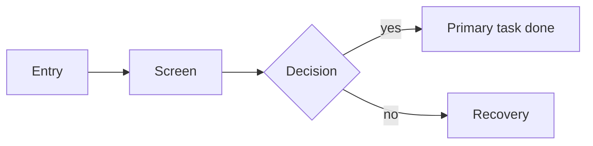

# Artifact skeletons

Copy the block, delete what does not apply, keep the headings stable so files
stay comparable across projects. Every artifact starts with the same header.

```md
# <Stage> — <project>
- Date: YYYY-MM-DD
- Project: <slug>
- Stage: <0-7 name>
- Gate: pending | approved | skipped by user (reason)
- Inputs: <files this was built from>
```

Labels used across every artifact:

| Label | Meaning |
|---|---|
| `evidence` | Backed by a source you can point at (transcript, analytics, screenshot, doc) |
| `assumption` | Reasoned but unverified |
| `unknown` | Not investigated yet |

---

## 00 · Brief

```md
## Problem
<One sentence: who is stuck doing what, and why it matters now.>

## Primary task
<The single action that must succeed. "As a <user>, I need to <task>.">

## Users (raw)
- <segment>: <context, current workaround>

## Constraints
- Platform / stack:
- Brand / existing system:
- Languages:
- Accessibility obligations:
- Timeline:

## Success signal
<Observable: task completion %, time on task, drop-off step, support volume.>

## Out of scope
- <what we agreed not to solve>

## Open questions
| # | Question | Owner | Needed by |
|---|---|---|---|
```

---

## 01 · Discovery

```md
## Jobs to be done
1. When <situation>, I want to <motivation>, so I can <outcome>. `evidence|assumption`

## Segments
### <Segment name>
- Context:
- Goal:
- Current workaround:
- Blocking friction:
- Decision this changes: <which design choice depends on this segment>

## Journey (current)
| Stage | Does | Thinks | Feels | Breaks |
|---|---|---|---|---|

## Assumptions (ranked)
| # | Assumption | Impact if wrong | How to test | Risk |
|---|---|---|---|---|

## Evidence
- <source>: <what it told us>
```

---

## 02 · IA & flows

```md
## Sitemap
- / (entry) — purpose
  - /screen — primary task
    - /child — primary task

## Primary flow


## Screen inventory
| Screen | Primary task | Entry | Exit | States |
|---|---|---|---|---|

## Content model
| Screen | Must say | Risky strings |
|---|---|---|

## Decisions log
| Decision | Alternative rejected | Why |
|---|---|---|
```

---

## 03 · Wireframes manifest

```md
| Screen | States built | Anchor | Notes |
|---|---|---|---|
| dashboard | default, empty, loading, error | 03-wireframes/flow.html#dashboard | tabs wired |

Flow: entry → screen A → screen B → success. Escape path: every screen links back.
```

---

## 04 · UI direction

```md
## Direction chosen
<2-3 sentences: how it serves the brief's tone, audience and density.>

## Direction rejected
<Name + why it lost.>

## Tokens
| Token | Role | Value |
|---|---|---|
| --surface | page background | #0b1014 |
| --text | primary text | #eef2f5 |
| --accent | primary action | #dd2c24 |
| --space-3 | block rhythm | 16px |
| --radius-sm | controls | 4px |
| --dur-fast | feedback | 120ms |

## Contrast (measured)
| Pair | Ratio | Passes |
|---|---|---|
| text on surface | 14.2:1 | AA/AAA |

## Proof screen
<Path or screenshot reference of the single screen that proves the system.>
```

---

## 05 · Usability test

```md
## Tasks
| # | Assumption tested | Task prompt (goal-worded) | Success | Failure signal |
|---|---|---|---|---|

## Script per task
- Setup:
- Prompt: "You want to <goal>. Show me how you would do it."
- Observe: <what counts as success>
- Follow-up: <neutral questions, no leading>
- Time budget:

## Environment matrix
| Device | Viewport | Input | Notes |
|---|---|---|---|

## Observations log
| T | Participant | Observation | Interpretation |
|---|---|---|---|

## Findings
| # | Finding | Severity | Fix |
|---|---|---|---|

## Confidence
<Expert walkthrough and/or N participants; what would raise confidence.>
```

---

## 06 · Audit

```md
| # | Severity | What | Where | Why it hurts the task | Fix | Rule |
|---|---|---|---|---|---|---|
| 1 | blocker | <issue> | <screen/region> | <user cannot…> | <one-line fix> | WCAG 2.4.7 / H3 |

## Blocking
- <short list of what must change before ship>

## Verdict
<2-3 sentences.>
```

---

## 07 · Handoff

```md
## Components
### <Component>
- Purpose:
- Anatomy:
- Variants:
- States: default · hover · focus-visible · active · disabled · loading · error · empty
- Behaviour / motion:

## Tokens
| Token | Value | Used by |
|---|---|---|

## Content & i18n
| Key | Default (ES) | Default (EN) | Budget | Notes |
|---|---|---|---|---|

## Accessibility per component
| Component | Role | Name | Keyboard | Focus | Announcements | Contrast min |
|---|---|---|---|---|---|---|

## Acceptance criteria
- Given <context>, when <action>, then <observable result>.

## Open decisions
| # | Decision | Owner | Deadline |
|---|---|---|---|
```
